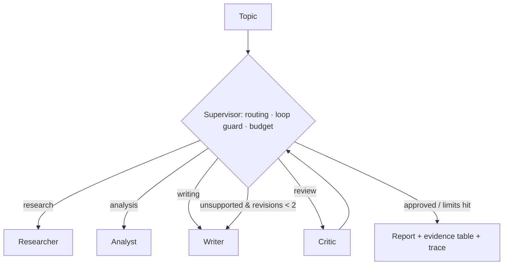

# Multi-Agent Research Assistant

> A supervisor-orchestrated team of four agents that turns a research topic into a structured, cited report with an evidence table — with hard limits on loops and budget, and a scan for evidence that contradicts itself.

**Author:** Amna Raheeba · Plain Python, runs fully offline with no API keys

---

## 1. Overview

### 1.1 The problem
Ask one LLM call to "research X and write a report" and you get fluent text with citations that may not support — or even contain — the claims attached to them. Splitting the work into agents only helps if something checks the joins between them.

### 1.2 The idea
A **supervisor** owns the flow, a **critic** can send a draft back for revision, and both operate under explicit limits: max iterations, max revisions, and a per-agent cost budget. The analyst's evidence table is also rebuilt as a **graph** of claims and sources, which is scanned for findings that contradict each other. That checking layer is what this project is about; the agents themselves are intentionally simple.

## 2. How It Works

### 2.1 Architecture



### 2.2 The agents

| Agent | Responsibility |
|---|---|
| **Researcher** | Collects sources with search tools; deduplicates; makes no claims of its own |
| **Analyst** | Extracts findings into an evidence table; scores source credibility (journal 0.90 → blog 0.30, with an age penalty); builds the claim↔source evidence graph |
| **Writer** | Drafts the structured report from the evidence table only, with `[S#]` citations; adds a **Conflicting Evidence** section when the graph flags a contradiction |
| **Critic** | Mechanically checks: every key finding is cited, and every cited claim exists in the evidence table; carries flagged contradictions into its critique |

### 2.3 Key concepts

- **Supervisor, not a chain** — the flow is conditional: after review, the run either finishes or loops back to the writer, decided from runtime state. The supervisor is an explicit state machine, not an LLM router — for four agents with a known flow, an LLM router would add cost and non-determinism, not capability.
- **Loops get hard limits** — max iterations (10) and max revisions (2) are enforced in one routing function, `decide_next()`.
- **Budget per agent** — `BudgetTracker` estimates tokens and cost per agent and stops the run over budget, so a revision loop shows exactly which agent is spending.
- **Revision by re-rendering** — the writer revises by re-rendering from the evidence table, so unsupported sentences drop by construction rather than by editing.
- **Evidence graph** — the flat evidence table is rebuilt as a bipartite graph: claim nodes and source nodes, joined by `supports` edges weighted by credibility (`research_team/evidence_graph.py`). Every CLI run exports it as `evidence_graph.json` next to the report, so the structure behind a report can be inspected without re-running anything.
- **Contradiction detection** — within the graph, finding pairs from *different* sources with opposing polarity (explicit negation vs positive outcome markers) over at least 3 shared content terms are flagged. The critic reports them and the writer gives them a Conflicting Evidence section; they are surfaced, never silently dropped, and they do not block approval — sources disagreeing is a finding, not an error. It is a documented heuristic: it catches blunt disagreement ("did not increase trust" vs "increased trust") and misses paraphrases.
- **Offline first** — default search runs over a small hand-written fixture corpus (13 original summaries, 3 topics). DuckDuckGo and arXiv tools are optional and fail soft.

## 3. Quick Start

```bash
# Python 3.10+, no dependencies for the demo
python -m research_team "explainable AI in healthcare"
python -m research_team "LLM agents and multi-agent systems" --show-budget --show-trace
python -m research_team "explainable predictive maintenance" -o report.md

pip install pytest && pytest -q                  # 24 tests
python -m research_team.evaluation.evaluate      # fixture evaluation
pip install streamlit && streamlit run dashboard/app.py   # live dashboard (see dashboard/README.md)
```

A full generated report is in [`examples/sample_report.md`](examples/sample_report.md) — 6 sources, 18 findings, 1 flagged contradiction, critic-approved, estimated run cost ≈ $0.0015. Its evidence graph is in [`examples/evidence_graph.json`](examples/evidence_graph.json) (24 nodes, 18 edges). Runs are checkpointed as JSON under `.runs/` and can be reloaded for inspection.

## 4. Project Structure

```
research_team/
├── supervisor.py        # routing (decide_next) · loop guard · BudgetTracker
├── state.py             # shared ResearchState / Source / Finding / Critique
├── evidence_graph.py    # claim↔source graph · contradiction detection · JSON export
├── config.py / memory.py / observability.py   # settings · JSON checkpointer · trace
├── agents/              # researcher · analyst · writer · critic
├── tools/               # fixture search (+ optional DuckDuckGo) · arXiv API
└── evaluation/          # completeness / citation / evidence coverage
dashboard/               # Streamlit app: live run, report, evidence graph, budget (dashboard/README.md)
data/fixtures.json       # 13 original source summaries across 3 topics
notebooks/               # 01 fixture-search debug · 02 contradiction scan
docs/experiment_log.md   # dated working notes, failures included
results/                 # contradiction_scan.csv, generated by notebook 02
examples/                # sample_report.md + its evidence_graph.json, from a real run
tests/                   # routing · budget guard · critic / revision · evidence graph · end-to-end
```

## 5. Design Decisions

| Decision | Why |
|---|---|
| Mechanical critic, not an LLM judge | The two checks (citation present, claim exists in evidence) are deterministic and unit-testable — and catch the most common failure: claims that were never in any source. |
| Shared state, no hidden agent memory | One dataclass every agent reads/writes; a run can be debugged from a single checkpoint file. |
| Credibility score labelled as a heuristic | It stops a blog post and a journal paper counting equally, without pretending to judge individual papers. |
| Contradictions are reported, not revised away | A disagreement between sources is evidence. The critic flags it, the writer sections it, and approval is not blocked — sending the writer back would not change what the sources say. |

## 6. Evaluation

On the 3 fixture topics: **section completeness 1.00 · citation coverage 1.00 · evidence coverage 1.00** (6 / 4 / 4 sources, 18 / 12 / 12 findings). The contradiction scan flags exactly 1 pair across all topics — S1 vs S13 on saliency maps and clinician trust (`results/contradiction_scan.csv`).

> Honest context: this is a 13-source hand-written corpus where the analyst generates the findings, so high coverage is expected. It is a regression check on the pipeline's plumbing — not evidence the system would score similarly on real literature.

## 7. Limitations & Roadmap

**Limitations:** fixture search is keyword + a small concept map, so it misses paraphrases an embedding search would catch · agents read short summaries, not full texts · the critic checks claim *presence*, not semantic equivalence · contradiction detection needs at least 3 shared content terms and explicit polarity markers, so paraphrased disagreement slips through · cost figures are estimates, not billed amounts · agents run sequentially.

**Roadmap:** embedding retrieval behind the same tool interface · entailment-based contradiction detection to replace the polarity heuristic · human-rated evaluation on unseen topics against a single-call baseline · parallel researcher calls for online search.

## License

MIT © 2026 Amna Raheeba — see [LICENSE](LICENSE).
